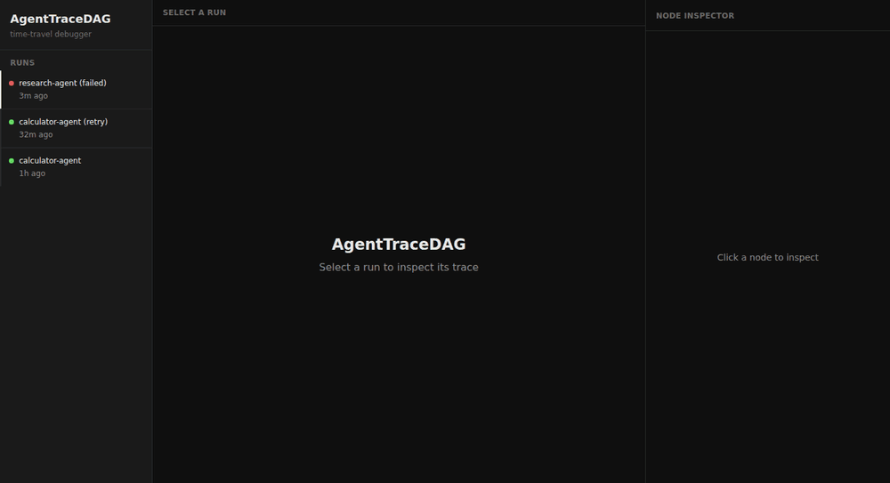
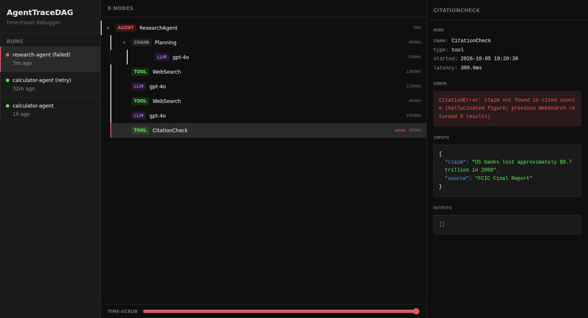

<h1 align="center">AgentTraceDAG</h1>

<p align="center"><em>Time-travel debugger for LLM agents — intercept every step, store it in a local SQLite DAG, scrub backward in time.</em></p>

<p align="center">
  
  
  
  
</p>

<p align="center">
  
</p>

When your agent fails on step 6 of 10, `stdout` JSON dumps are useless. AgentTraceDAG intercepts every step, stores the exact state into a local SQLite DAG, and gives you a dashboard to scrub *backward in time* — seeing the precise context window, tool payloads, and token usage at any millisecond.

---

## Why AgentTraceDAG?

| Problem | AgentTraceDAG |
|---|---|
| Agent hallucinates on step 4 | Time-scrub slider rewinds to exactly what the LLM saw |
| Agent loops — why won't it break out? | Visual diff context window iteration 3 vs 4 (roadmap) |
| "It worked last time!" | Every run is immutably stored — replay any historical execution |
| Debugging across frameworks | LangChain, OpenAI, Anthropic, smolagents — one tool |
| Telemetry goes to the cloud | Zero-telemetry. Everything stays on your machine. |

---

## Quick Start

```bash
pip install agenttracedag
```

### LangChain (drop-in callback)

```python
from agenttracedag.interceptors.langchain import AgentTraceDAGCallback

cb = AgentTraceDAGCallback(run_name="my-research-agent")
result = agent.invoke({"input": "What caused the 2008 financial crisis?"},
                      config={"callbacks": [cb]})

cb.serve()  # opens http://localhost:7474
```

### Raw OpenAI (monkey-patch)

```python
from agenttracedag.interceptors.openai_patch import patched
import agenttracedag

run = agenttracedag.Run(name="openai-debug", start_time=__import__("time").time())
agenttracedag.get_default_store().upsert_run(run)

with patched(run.id):
    response = openai.OpenAI().chat.completions.create(
        model="gpt-4o",
        messages=[{"role": "user", "content": "Hello"}]
    )

agenttracedag.serve()  # http://localhost:7474
```

### Anthropic

```python
from agenttracedag.interceptors.anthropic_patch import patched

with patched(run.id):
    response = anthropic.Anthropic().messages.create(...)
```

### smolagents

```python
from agenttracedag.interceptors.smolagents_patch import wrap

wrapped_agent = wrap(agent, run_name="my-smolagent")
result = wrapped_agent.run("Solve this problem")
```

---

## Dashboard



**Try it in 30 seconds — no API keys:**

```bash
pip install -e .
python examples/seed_demo.py --db demo.db   # 3 sample runs, one fails at step 8
python -m agenttracedag --db demo.db
```

**Usage:**

```bash
# Start the dashboard (opens http://localhost:7474)
python -m agenttracedag

# Custom port or DB path
python -m agenttracedag --port 8080 --db /path/to/.agenttracedag.db
```

**Three-panel layout:**

```
┌──────────────┬─────────────────────────┬──────────────────────┐
│   Run List   │     Timeline (DAG)      │   Payload Inspector  │
│              │                         │                      │
│ • run-1  ✓  │ ▾ 🤖 AGENT ResearchAgent│ name: gpt-4o         │
│ • run-2  ✗  │   ▾ ⛓ CHAIN Planning    │ latency: 843ms       │
│ • run-3  ●  │     🧠 LLM gpt-4o       │ tokens: 274          │
│             │   🔧 TOOL WebSearch      │                      │
│             │   🧠 LLM gpt-4o         │ inputs: {            │
│             │ ─────────────────────── │   "prompts": [...]   │
│             │ [time-scrub slider ────]│ }                    │
└─────────────┴─────────────────────────┴──────────────────────┘
```

**Time-scrub:** Drag the slider to roll back the agent's visible state to any point in time. See exactly what the LLM saw before it went wrong.

---

## Architecture

```mermaid
flowchart TD
    A[Your Agent Code] --> B[Auto-Interceptors]

    subgraph B[Auto-Interceptors]
        B1[LangChain Callback]
        B2[OpenAI Patch]
        B3[Anthropic Patch]
        B4[smolagents Wrapper]
    end

    B --> C[SQLite Event Store\n.agenttracedag.db\nruns + trace_nodes DAG]
    C --> D[FastAPI Server\nGET /api/runs\nGET /api/runs/{id}/nodes]
    D --> E[React + Tailwind Dashboard\nRunList · Timeline · ScrubBar · PayloadInspector]
```

---

## Data Model

Every agent step is an **immutable DAG node**:

```python
class TraceNode(BaseModel):
    id: str           # UUID
    run_id: str       # links to parent Run
    parent_id: str    # links to parent Node (DAG structure)
    node_type: NodeType  # AGENT | CHAIN | LLM | TOOL

    start_time: float
    end_time: float

    inputs: dict      # exact payload sent to LLM/tool
    outputs: dict     # exact response received
    error: str        # exception message if failed
    token_usage: dict # prompt_tokens, completion_tokens, total_tokens
    model_name: str   # e.g. "gpt-4o"
```

---

## Security

AgentTraceDAG is a **local-only development tool**. It is designed for use on your own machine:

- Server binds to `127.0.0.1` by default (not network-accessible)
- CORS restricted to localhost origins only
- No telemetry, no cloud, no accounts
- All data stays in `.agenttracedag.db` on your filesystem

**Important:** LLM prompts often contain sensitive data (API keys, PII, customer data). The database is stored as plaintext SQLite. Do not commit `.agenttracedag.db` to git. Add it to `.gitignore`:

```
.agenttracedag.db
```

See [open security issues](https://github.com/Gustav-Proxi/agenttracedag/labels/security) for planned hardening (encryption at rest, auth, TLS).

---

## Roadmap

| Feature | Status |
|---|---|
| LangChain interceptor | ✅ Done |
| OpenAI + Anthropic patches | ✅ Done |
| smolagents wrapper | ✅ Done |
| Time-scrub slider | ✅ Done |
| DB indexes + retention policy | ✅ Done |
| **Fork & Replay** | 🗺️ Planned |
| **Visual diffing** | 🗺️ Planned |
| **Live WebSocket streaming** | 🗺️ Planned |
| **Gemini + Mistral interceptors** | 🗺️ Planned |
| **pytest plugin** | 🗺️ Planned |
| **Trace export/import** | 🗺️ Planned |
| **Token cost calculator** | 🗺️ Planned |

---

## Contributing

We welcome contributions! See [CONTRIBUTING.md](CONTRIBUTING.md) for setup instructions.

Good first issues are tagged [`good first issue`](https://github.com/Gustav-Proxi/agenttracedag/labels/good%20first%20issue).

---

## Related Projects

- [VectorLens](https://github.com/Gustav-Proxi/vectorlens) — sister tool for RAG pipelines. Token-level attribution showing which retrieved chunks caused each output sentence.
- [Arize Phoenix](https://github.com/Arize-ai/phoenix) — full observability platform (evaluation, datasets). AgentTraceDAG is narrower: a debugger, not a platform.
- [LangSmith](https://smith.langchain.com) — cloud-hosted tracing for LangChain. AgentTraceDAG is local-first with zero telemetry.

---

## License

MIT — see [LICENSE](LICENSE).
